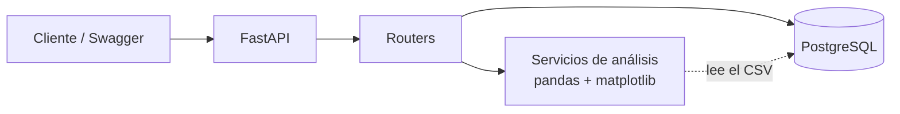

# DataLens API

API REST construida con **FastAPI** que recibe archivos CSV y devuelve automáticamente un análisis de los datos: estadísticas descriptivas, valores nulos, correlaciones y gráficos.


**Demo en vivo (Swagger):** `TODO: https://datalens-api-qv3n.onrender.com/docs`
> El servicio gratuito se "duerme" tras unos minutos sin tráfico; la primera petición puede tardar cerca de un minuto en responder.

---

## - Objetivo

Proyecto personal para practicar y demostrar un ciclo completo de desarrollo backend en Python:

- APIs modernas con **FastAPI**, Pydantic y SQLAlchemy.
- Análisis de datos con **pandas**.
- **Pruebas automatizadas** (47 pruebas, 100% de cobertura).
- **CI/CD** con GitHub Actions.
- **Contenerización** con Docker y despliegue en la nube con PostgreSQL.

---

## - Funcionalidades

- Subida y validación de archivos CSV (extensión, tamaño y contenido).
- Resumen por columna: tipo, nulos, valores únicos, media, mediana, mínimo, máximo y desviación estándar.
- Matriz de correlación entre columnas numéricas.
- Histogramas en PNG por columna.
- Detección automática de columnas identificadoras (`id`, `index`, `ean`, `sku`...) para no mezclarlas en estadísticas ni correlaciones.
- Paginación en el listado y eliminación de datasets.
- Manejo global de errores y registro (logging) de cada petición.

---

## - Stack tecnológico

| Área | Tecnología |
|------|-----------|
| Framework | FastAPI |
| Análisis de datos | pandas, matplotlib |
| Base de datos | PostgreSQL (SQLite en local), SQLAlchemy 2, psycopg 3 |
| Validación | Pydantic v2 |
| Pruebas | pytest, pytest-cov, httpx |
| Calidad de código | ruff |
| Contenedores | Docker, Docker Compose |
| CI/CD | GitHub Actions |
| Despliegue | Render (API) + Neon (PostgreSQL) |

---

## - Arquitectura



```
datalens-api/
├── app/
│   ├── main.py            # app, middleware de logging, ciclo de vida
│   ├── config.py          # configuración por variables de entorno
│   ├── database.py        # motor y sesiones SQLAlchemy
│   ├── errors.py          # manejadores globales de errores
│   ├── logging_config.py
│   ├── models/            # tablas
│   ├── schemas/           # modelos Pydantic (entrada/salida)
│   ├── routers/           # endpoints
│   └── services/analysis.py   # lógica de análisis (independiente de FastAPI)
├── tests/
├── .github/workflows/ci.yml
├── Dockerfile
└── docker-compose.yml
```

---

## 🔌 Endpoints

| Método | Ruta | Descripción |
|--------|------|-------------|
| GET | `/health` | Estado del servicio |
| POST | `/datasets` | Sube un CSV |
| GET | `/datasets?skip=0&limit=20` | Lista los datasets (paginado) |
| GET | `/datasets/{id}/summary` | Estadísticas por columna |
| GET | `/datasets/{id}/correlations` | Matriz de correlación |
| GET | `/datasets/{id}/chart?column=&bins=` | Histograma (PNG) |
| DELETE | `/datasets/{id}` | Elimina un dataset |

**Códigos de error:** `415` extensión no permitida · `413` archivo demasiado grande · `422` contenido inválido o columna no graficable · `404` dataset inexistente · `500` error interno (mensaje genérico, el detalle queda en los logs).

### Ejemplo

```bash
curl -X POST "http://localhost:8000/datasets" -F "file=@ventas.csv"
curl "http://localhost:8000/datasets/1/summary"
curl "http://localhost:8000/datasets/1/chart?column=precio" --output precio.png
```

---

## - Ejecución local

### Con entorno virtual (SQLite)

```bash
git clone https://github.com/jro51/datalens-api.git
cd datalens-api

python -m venv venv
source venv/bin/activate        # Windows: venv\Scripts\activate
pip install -r requirements-dev.txt

cp .env.example .env            # Windows: copy .env.example .env
uvicorn app.main:app --reload
```

Abre `http://localhost:8000/docs`.

### Con Docker Compose (API + PostgreSQL)

```bash
docker compose up --build
```

---

## - Pruebas y calidad

```bash
pytest --cov=app --cov-report=term-missing
ruff check .
```

Se prueban la lógica de análisis (casos normales, nulos, CSV vacío o malformado, columnas identificadoras), todos los endpoints (casos felices y de error), el manejo global de errores, el logging y la configuración. Cada prueba usa una base SQLite en memoria aislada.

---

## - CI/CD

`.github/workflows/ci.yml` se ejecuta en cada push y pull request:

1. **test**: instala dependencias, `ruff` y `pytest` con cobertura mínima de 80%.
2. **docker**: construye la imagen y hace una prueba de humo (el contenedor debe responder en `/health`).
3. **deploy** (solo en `main` y solo si lo anterior pasó): dispara el despliegue en Render mediante un *deploy hook*.

---

## - Decisiones técnicas

- **Capa de servicios separada de FastAPI:** `analysis.py` no conoce HTTP, así que se prueba de forma aislada y rápida.
- **El CSV se guarda en la base de datos (`bytea`) y no en disco:** los servicios gratuitos en la nube tienen sistema de archivos efímero; guardar el contenido en PostgreSQL evita perder datos al reiniciar. La columna es *deferred*, por lo que el listado no carga los archivos.
- **Manejadores globales de errores:** los errores de negocio (`AnalysisError`) se convierten en `422` en un solo lugar y los inesperados devuelven un `500` genérico sin filtrar detalles internos.
- **Detección de identificadores:** columnas como `Index`, `EAN` o `Internal ID` son numéricas pero no tienen sentido estadístico; se marcan y se excluyen de medias y correlaciones.
- **Límite de tamaño y lectura acotada:** se leen como máximo `límite + 1` bytes para no agotar la memoria.
- **Endpoints síncronos (`def`):** pandas bloquea el hilo; FastAPI los ejecuta en un pool de hilos y no frena el servidor.
- **`pool_pre_ping`:** evita errores por conexiones caídas cuando la base serverless se suspende por inactividad.
- **Contenedor sin root y con `HEALTHCHECK`.**

---


