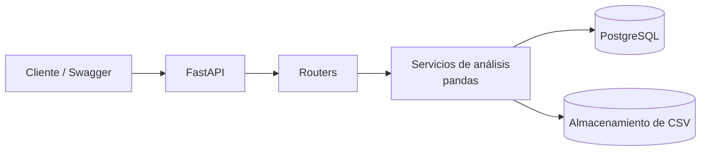

# 📊 DataLens API

API REST construida con **FastAPI** que permite subir archivos CSV y obtener automáticamente un análisis de los datos: estadísticas descriptivas, valores nulos, correlaciones y gráficos.


🔗 **Demo en vivo:** `TODO: https://tu-app.onrender.com/docs`

---

## - Objetivo

Proyecto personal para practicar y demostrar:

- Desarrollo de APIs modernas con **FastAPI** y **Python**.
- **Pruebas automatizadas** (unitarias y de integración) con pytest.
- **CI/CD** con GitHub Actions.
- **Contenerización** con Docker y despliegue en la nube.

---

## - Funcionalidades

- Subida y validación de archivos CSV (formato y tamaño).
- Resumen estadístico por columna: tipo, nulos, media, mediana, mínimo y máximo.
- Matriz de correlación entre columnas numéricas.
- Generación de histogramas en PNG por columna.
- Listado y eliminación de datasets.
- Documentación interactiva con Swagger (`/docs`).

---

## Stack tecnológico

| Área | Tecnología |
|------|-----------|
| Framework | FastAPI |
| Análisis de datos | pandas, matplotlib |
| Base de datos | PostgreSQL (SQLite en desarrollo), SQLAlchemy |
| Validación | Pydantic |
| Pruebas | pytest, pytest-cov, httpx |
| Calidad de código | ruff |
| Contenedores | Docker, Docker Compose |
| CI/CD | GitHub Actions |
| Despliegue | TODO: Render / Railway / Fly.io |

---

## Arquitectura



### Estructura del proyecto

```
datalens-api/
├── app/
│   ├── main.py
│   ├── config.py
│   ├── database.py
│   ├── models/
│   ├── schemas/
│   ├── routers/
│   │   └── datasets.py
│   └── services/
│       └── analysis.py
├── tests/
│   ├── test_analysis.py
│   └── test_datasets.py
├── .github/workflows/ci.yml
├── Dockerfile
├── docker-compose.yml
├── requirements.txt
└── README.md
```

---

## Endpoints

| Método | Ruta | Descripción |
|--------|------|-------------|
| GET | `/health` | Estado del servicio |
| POST | `/datasets` | Sube un CSV |
| GET | `/datasets` | Lista los datasets |
| GET | `/datasets/{id}/summary` | Estadísticas descriptivas |
| GET | `/datasets/{id}/correlations` | Matriz de correlación |
| GET | `/datasets/{id}/chart?column=` | Histograma (PNG) |
| DELETE | `/datasets/{id}` | Elimina un dataset |

### Ejemplo de uso

```bash
curl -X POST "http://localhost:8000/datasets" \
  -F "file=@ventas.csv"

curl "http://localhost:8000/datasets/1/summary"
```

Respuesta de ejemplo:

```json
{
  "rows": 1200,
  "columns": 5,
  "stats": {
    "precio": { "dtype": "float64", "nulls": 3, "mean": 45.2, "median": 40.0, "min": 5.0, "max": 120.0 }
  }
}
```

---

## - Ejecución local

### Requisitos

- Python 3.12+
- Docker y Docker Compose (opcional)

### Con entorno virtual

```bash
git clone https://github.com/jro51/datalens-api.git
cd datalens-api

python -m venv venv
source venv/bin/activate        # Windows: venv\Scripts\activate
pip install -r requirements.txt

cp .env.example .env
uvicorn app.main:app --reload
```

Abre `http://localhost:8000/docs`.

### Con Docker Compose

```bash
docker compose up --build
```

---

## - Pruebas

```bash
pytest --cov=app --cov-report=term-missing
```

Se prueban:

- La lógica de análisis (casos normales, columnas con nulos, CSV vacío).
- Los endpoints (subida válida, archivo inválido, dataset inexistente).

---

## - CI/CD

El workflow `.github/workflows/ci.yml` se ejecuta en cada push y pull request:

1. Instala dependencias.
2. Ejecuta `ruff` (lint).
3. Corre las pruebas con cobertura.
4. Construye la imagen Docker.

El despliegue se realiza TODO: automáticamente desde la rama `main` / manualmente en la plataforma elegida.

---

## - Decisiones técnicas

- **FastAPI**: validación automática con Pydantic y documentación Swagger sin configuración extra.
- **pandas**: estándar para análisis tabular; permite resolver estadísticas y correlaciones con poco código.
- **Capa de servicios separada**: la lógica de análisis no depende de FastAPI, lo que facilita probarla de forma aislada.
- **Límite de tamaño de archivo**: evita consumo excesivo de memoria en el servidor.
- TODO: agrega aquí 1 o 2 decisiones propias que tomes durante el desarrollo.

---

